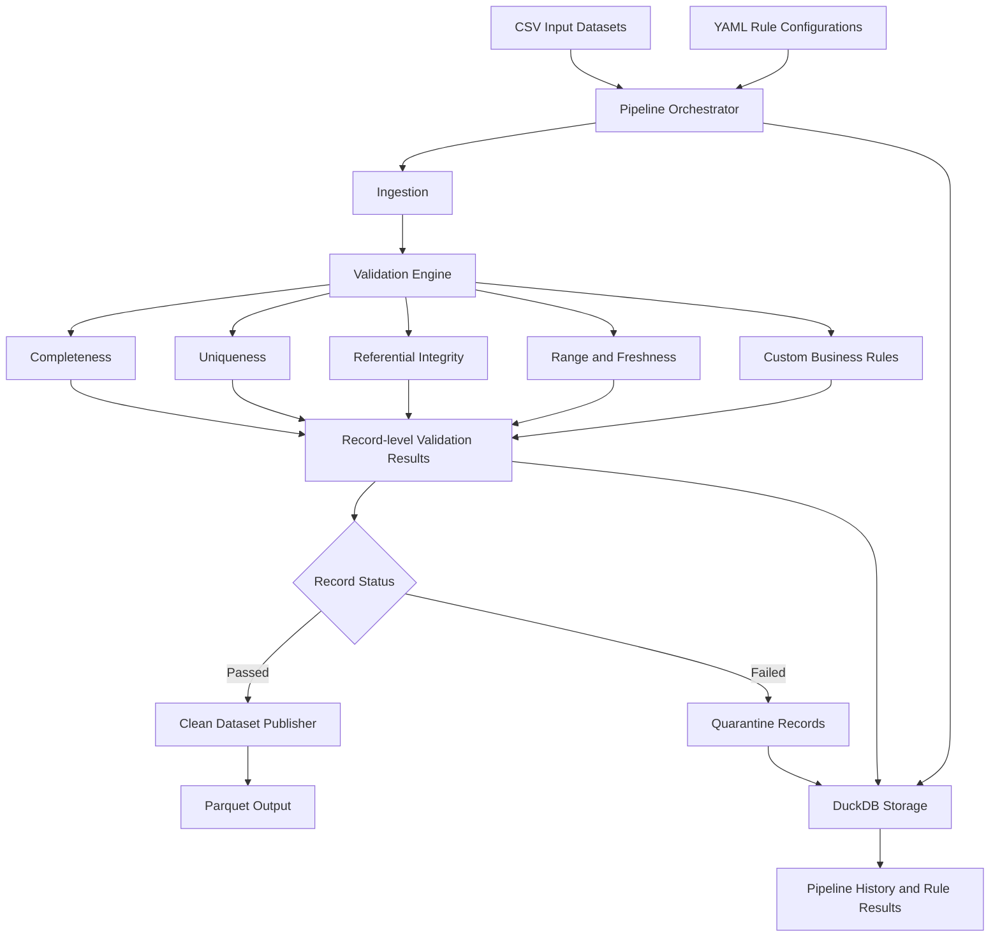

# Data Quality Engine — Architecture

## 1. Architecture Overview

The Data Quality Engine follows a modular, configuration-driven architecture. It ingests CSV datasets, validates records using YAML-defined rules, publishes clean records as Parquet files, and stores execution results and rejected records in DuckDB.

## 2. Architecture Diagram

## 3. Processing Flow

1. **Input ingestion:** Read customer and order CSV files.
2. **Configuration loading:** Load dataset-specific validation rules from YAML files.
3. **Data validation:** Execute configured checks through the validation engine.
4. **Reference validation:** Use customer records to validate customer references in orders.
5. **Record classification:** Identify records that pass or fail one or more validation rules.
6. **Clean data publishing:** Write accepted records to run-specific Parquet output locations.
7. **Quarantine management:** Store rejected records and their associated failed rules in DuckDB.
8. **Execution tracking:** Persist pipeline status, record counts, and rule-level results.

## 4. Storage Design

| Storage | Purpose |
|---|---|
| CSV | Raw input datasets |
| YAML | Dataset schemas and validation rules |
| Parquet | Clean, validated datasets |
| DuckDB | Pipeline runs, rule results, and quarantined records |

## 5. Key Design Characteristics

- **Configurable:** Validation rules are maintained separately from Python code.
- **Modular:** Individual validation checks are implemented independently.
- **Traceable:** Each execution is identified by a unique run ID.
- **Recoverable:** Pipeline failures are recorded with error details.
- **Idempotent:** Reusing a run ID updates persisted results rather than creating duplicate records.
- **Reconciled:** Input records are accounted for as either clean or quarantined records.