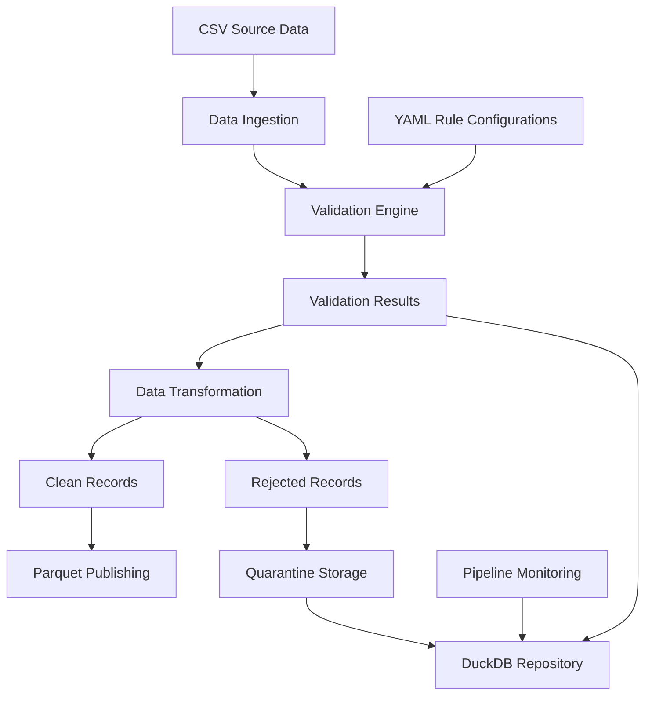

# Configurable Data Quality Engine


A configurable, Python-based data quality engine designed to validate, transform, and publish reliable datasets using YAML-driven validation rules.

The project demonstrates an end-to-end data quality pipeline with configurable checks, record-level quarantine, persistent execution history, safe reruns, and scalable data processing.

## 1. Project Overview

The engine processes customer and order datasets through a configurable data quality framework.

It supports:

- YAML-based validation rule configuration.
- Completeness and uniqueness checks.
- Referential integrity validation.
- Range and freshness checks.
- Custom business rule validation.
- Clean data publishing in Parquet format.
- Rejected record quarantine.
- Pipeline execution and rule-level result tracking.
- Safe reruns using reusable run IDs.
- Data reconciliation and performance measurement.

## 2. Architecture



### Processing Flow

1. Read customer and order datasets from CSV files.
2. Load validation rules from YAML configuration files.
3. Execute configured data quality checks.
4. Identify records that fail one or more validation rules.
5. Publish clean records as Parquet files.
6. Store rejected records in quarantine.
7. Persist pipeline execution details and rule-level results in DuckDB.
8. Track execution status, record counts, and errors.

Customer data is loaded first and used as a reference dataset when validating order records.

## 3. Technology Stack

| Component | Technology |
|---|---|
| Programming Language | Python 3.12 |
| Data Processing | Pandas |
| Database | DuckDB |
| Configuration | YAML |
| File Formats | CSV, Parquet |
| Parquet Engine | PyArrow |
| Testing | Pytest |
| Logging and Monitoring | Python logging / execution tracking |

## 4. Project Structure

```text
yottaflex-data-quality/
│
├── config/
│   ├── datasets.yaml
│   └── rules/
│       ├── customers.yaml
│       └── orders.yaml
│
├── data/
│   ├── raw/
│   ├── generated/
│   ├── output/
│   │   ├── clean/
│   │   └── quality_engine.duckdb
│   └── quarantine/
│
├── src/
│   ├── ingestion/
│   ├── validation/
│   │   ├── completeness.py
│   │   ├── uniqueness.py
│   │   ├── referential_integrity.py
│   │   ├── range_check.py
│   │   ├── freshness.py
│   │   ├── custom_rules.py
│   │   └── engine.py
│   ├── transformation/
│   │   └── publisher.py
│   ├── storage/
│   │   ├── database.py
│   │   └── repository.py
│   └── pipeline.py
│
├── scripts/
├── tests/
├── reports/
├── docs/
│   └── data_dictionary.md
│
└── README.md
```

## 5. Supported Data Quality Checks

| Check | Description |
|---|---|
| Completeness | Identifies null and empty values |
| Uniqueness | Identifies duplicate values |
| Referential Integrity | Validates references between datasets |
| Range | Checks values against configured boundaries |
| Freshness | Identifies stale or future timestamps |
| Allowed Values | Validates values against an approved list |
| Conditional Rules | Validates fields based on business conditions |
| Email Format | Validates email address formats |

Validation rules are maintained separately from the Python implementation, allowing new rules to be configured through YAML.

## 6. Installation and Setup

### Prerequisites

- Python 3.12 or later
- Git

### Clone the repository

```bash
git clone https://github.com/ajayarya3803-code/yottaflex-data-quality-engine.git
cd yottaflex-data-quality-engine
```

### Create a virtual environment

```bash
python -m venv .venv
```

Activate it on Windows:

```powershell
.venv\Scripts\Activate.ps1
```

### Install dependencies

```bash
pip install -r requirements.txt
```

## 7. Running the Pipeline

### Process sample datasets

```bash
python -m src.pipeline
```

The default input directory is:

```text
data/raw/
```

### Process generated datasets

```bash
python -m src.pipeline --input-dir data/generated
```

### Reuse an existing run ID

```bash
python -m src.pipeline --input-dir data/generated --run-id <EXISTING_RUN_ID>
```

Reusing a run ID updates the corresponding run-scoped results instead of creating duplicate database records.

## 8. Data Storage

### Clean Data

Validated records are published in Parquet format.

```text
data/output/clean/
    customers/
        run_id=<RUN_ID>/
            data.parquet
    orders/
        run_id=<RUN_ID>/
            data.parquet
```

### Quarantine Data

Records failing one or more validation rules are stored in DuckDB with their dataset, record index, record content, and failed rule information.

Each rejected record is stored once per run, even when it fails multiple rules.

### Execution Metadata

DuckDB maintains three tables:

- `pipeline_runs`: Pipeline execution status, timestamps, record counts, and error messages.
- `rule_results`: Dataset-level validation results for individual rules.
- `quarantine_records`: Rejected record details and associated failed rules.

## 9. Testing

Run the complete test suite:

```bash
python -m pytest tests/ -v
```

Run tests with coverage:

```bash
python -m pytest tests/ --cov=src --cov-report=term-missing
```

The current test suite contains 18 passing tests covering:

- Individual validation rules.
- Validation engine execution.
- Empty and malformed records.
- Missing required columns.
- Business-specific edge cases.
- Clean data publishing.
- Storage operations.

Latest recorded test result: **18 passed**.

## 10. Large-Scale Data Processing and Benchmark

The project includes a reproducible large-data generator that creates:

- 100,000 customer records.
- 300,000 order records.
- Injected data quality issues for validation testing.

### Benchmark Results

| Metric | Customers | Orders | Total |
|---|---:|---:|---:|
| Input records | 100,000 | 300,000 | 400,000 |
| Clean records | 98,507 | 290,246 | 388,753 |
| Rejected records | 1,493 | 9,754 | 11,247 |

**Recorded benchmark execution:**

- Total input: 400,000 records.
- Clean records: 388,753.
- Quarantined records: 11,247.
- Execution time: 8.90 seconds.
- Approximate throughput: 44,944 records per second.
- Reconciliation: Successful.

Benchmark results are environment-dependent and may vary across machines.

The pipeline reports `COMPLETED_WITH_ERRORS` when records are rejected by validation rules. This is an expected outcome when input data contains quality issues, not a pipeline execution failure.

## 11. Reliability and Error Handling

The pipeline includes:

- Run-level execution tracking.
- Persistent error messages.
- Failed execution status.
- Run-scoped output directories.
- Database UPSERT operations.
- Quarantine replacement for reused run IDs.
- Atomic replacement of published Parquet files.

Missing input files and malformed CSV files have been tested. Subsequent valid pipeline executions also complete successfully.

## 12. Design Decisions and Trade-offs

- **Pandas:** Provides straightforward tabular processing and is sufficient for the challenge's dataset sizes.
- **DuckDB:** Provides lightweight analytical storage without requiring a separate database server.
- **YAML:** Separates validation configuration from implementation code.
- **Parquet:** Provides a columnar output format suitable for analytical workloads.
- **Run-scoped outputs:** Preserve historical executions and prevent different runs from overwriting each other's outputs.
- **Quarantine:** Keeps rejected records available for investigation instead of silently discarding them.

The architecture can be extended to distributed processing and cloud-based storage as future production enhancements.

## 13. Future Enhancements

Potential production extensions include:

- Distributed processing using Apache Spark.
- Cloud storage integration.
- Scheduled pipeline orchestration.
- Data quality dashboards.
- Additional configurable validation rules.

---

**Project:** Configurable Data Quality Engine

**Focus:** Data Engineering | ETL/ELT | Data Quality | Python | Pandas | DuckDB | Parquet
